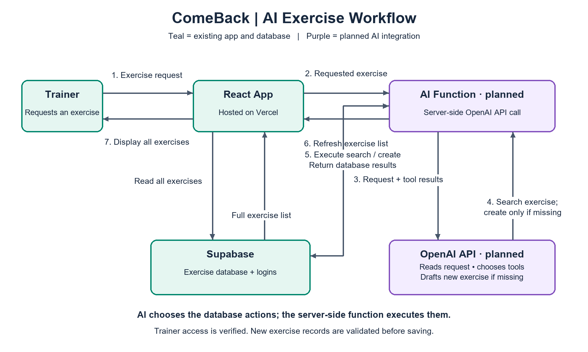
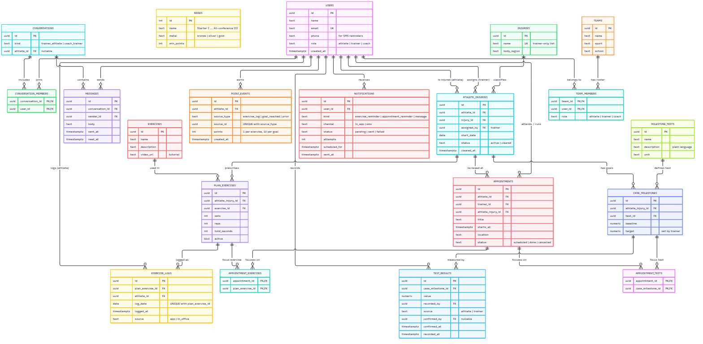

# Comeback

Injury rehab tracker that connects college athletes, their athletic trainer and their coach. Built for IS 401 (BYU, Fall 2026). See `PLAN.md` for the full build plan and `reference/` for the original prototype.

## System Architecture



The React app hosted on Vercel uses Supabase for logins and exercise data. The **planned AI exercise workflow** works as follows:

1. A trainer requests an exercise in the React app.
2. React sends the request to a server-side AI function, which calls the OpenAI API.
3. OpenAI reads the request and requests a database search through a tool call. The function executes the search against Supabase and returns the result to OpenAI.
4. If the exercise exists, the workflow reuses it. If it is missing, OpenAI drafts the exercise and requests a create tool call; the function checks trainer authorization, validates the record, and saves it in Supabase.
5. When the workflow completes, React reloads the full authorized exercise catalog from Supabase so the trainer can see all exercises.

OpenAI selects tool actions; the server-side function performs database operations. The AI function and OpenAI integration are planned. Existing optional push reminders are omitted from this simplified overview.

## App Summary

When a college athlete gets hurt, the athletic trainer hands them a rehab plan, but the trainer only sees the athlete at scheduled visits and has no way to know whether the exercises are actually getting done in between. Athletes lose track of what they are supposed to do each day, do not know whether they are on pace to return, and have no easy way to tell the trainer when something hurts. Coaches sit in the dark: they want to know who is available for practice and when, but the trainer cannot share medical details with them. Comeback fixes this by giving each role its own view of one shared record. The trainer assigns an injury, exercises and milestone goals; the athlete logs each exercise with a pain rating, and tracks milestone tests on a road-to-recovery view; the trainer sees completion, pain flags and messages on a roster; and the coach sees only availability (Out, Limited, Cleared), an expected return date, and a weekly progress summary in counts (exercises done, goals reached) with no medical details. Every log, result and message is stored in a Supabase database, so all three people see the same data and nothing resets on refresh.

## ERD



**Athletes and injuries are many-to-many.** `athlete_injuries` is the junction table between `users` (athletes) and the `injuries` catalog: one athlete can have several injuries at once, and one injury (say, "Ankle sprain") can be on many athletes. Each row is an injury *case* with its own exercise plan, goals and appointments. An athlete can't have the same injury open twice at once (a partial unique index on active cases), but can get a new case for it after the old one is cleared. The athlete's daily list is the exercises from all their active cases.

The diagram source is `reference/erd.mmd` (Mermaid). The database is built from it by `supabase/erd_schema.sql`. Two things were added after the diagram was drawn and are in the database but not yet in the image: a `pain` column on `exercise_logs` (0 to 10, required for app logs) and `availability` / `expected_return` columns on `team_members` (what the coach sees). The `notifications` table is created by `supabase/push.sql` for push reminders, with a `push` channel, a `missed_exercises` kind, and the title and body added; that script also adds `push_subscriptions` (one row per device with reminders on).

Core entities and how they relate:

| Entity | What it is | Key relationships |
|---|---|---|
| `users` | One row per person, linked 1:1 to their Supabase login. Role is athlete, trainer or coach. | 1 user : many `team_members`, `exercise_logs`, `messages` |
| `teams` / `team_members` | The roster. Membership decides who can see whom. | many users : many teams (through `team_members`) |
| `athlete_injuries` | One injury case for one athlete, assigned by a trainer. | 1 athlete : many cases; 1 case : many `plan_exercises`, `case_milestones`, `appointments` |
| `exercises` / `plan_exercises` | Catalog of exercises, and the sets/reps prescribed for one case. | many exercises : many cases (through `plan_exercises`) |
| `exercise_logs` | One row each time an athlete marks an exercise done, with a pain rating. Unique per exercise per day. | 1 `plan_exercise` : many logs |
| `milestone_tests` / `case_milestones` / `test_results` | Tests like "One-leg balance", the target set for one case, and each measured value. | 1 milestone : many results |
| `appointments` | Upcoming visits, with the tests and exercises to focus on. | 1 case : many appointments |
| `conversations` / `messages` | One thread per athlete with the trainer, and one coach-to-trainer thread. | 1 conversation : many messages |

## Tech Stack

| Layer | What we used | Why |
|---|---|---|
| Frontend | React 19 + TypeScript, built with Vite | Smallest setup that still gives component structure and type checking. Vite starts in seconds and hot-reloads. |
| Routing | react-router-dom | Separate URLs for athlete and staff screens, so a role can be sent to its own home. |
| State | React Context + `useReducer` (`src/store`) | No extra library to learn. Loading from and saving to the database lives in one file (`remote.ts`), so the screens never talk to Supabase directly. |
| Business rules | Plain TypeScript functions in `src/domain`, tested with Vitest | Streaks, goal progress and week-completion are pure functions with tests, so we can change thresholds without touching the UI. |
| Backend + database | Supabase (hosted PostgreSQL, Auth, auto-generated REST API) | Backend as a service. Zero server code to write or host, a free tier that covers a class project, and a dashboard where we can see every table and row. Row level security in the database enforces who can see what (a coach can never read an athlete's injury or pain). |
| Automatic rules | PostgreSQL triggers in `supabase/erd_schema.sql` | New logins get their `users` row from the database itself, so it exists no matter how someone signed up. |
| Hosting | Vercel (`vercel.json` routes every path to `index.html`) | Free static hosting with a public URL for demos and phone testing. |
| Styling | Plain CSS with variables (`src/styles/tokens.css`) | No UI library. Everything is readable and editable by a team still learning to code. |

Why this fits our team: nobody on the team wanted to run a server, and we needed to see the data to debug it. Supabase gives us a real database and login without an Express layer, and the Table Editor doubles as our admin tool. React with TypeScript was the one frontend stack everyone had touched. The trade-off is less control than a hand-built stack, which we accepted for a semester project.

## How to Get It Running

You need Node.js 20 or newer, npm, and a free Supabase account.

### 1. Get the code

```
git clone https://github.com/bpickard38/ComeBack.git
cd ComeBack
npm install
```

Or click **Code > Download ZIP** on GitHub, unzip it, and run `npm install` inside the folder.

### 2. Create the Supabase project (once per team)

1. At supabase.com, create a new project. Any name and region. Write down the database password.
2. Open **SQL Editor** and run these nine files in order. Paste each file's contents into a new query and click Run.
   1. `supabase/erd_schema.sql`: the tables, triggers, security rules and catalogs
   2. `supabase/signup.sql`: roles, teams and join codes
   3. `supabase/live_data.sql`: conversations and plan assignment the screens use
   4. `supabase/multi_injury.sql`: lets an athlete have several active injuries at once
   5. `supabase/workout_sets.sql`: tutorial videos for every exercise and a workout set per injury
   6. `supabase/weekly_summary.sql`: the coach's weekly progress summary (counts only)
   7. `supabase/athlete_notes.sql`: private trainer notes on player profiles
   8. `supabase/coach_athlete_chat.sql`: the private trainer and coach conversation about one athlete
   9. `supabase/demo_data.sql`: the demo team (optional, see Demo accounts)

   Already set up? Run `supabase/remove_trophies.sql` once (after deploying the app version without trophies) and any later migrations you have not applied. If the project predates `multi_injury.sql`, run that too, then `workout_sets.sql` and `weekly_summary.sql`. Re-run `supabase/push.sql` if you use push reminders.
3. Under **Authentication > Sign In / Providers**, turn on "Allow new users to sign up". Under Email, turn off "Confirm email" unless you want people to confirm by email first.

### 3. Connect the app to your project

1. Copy `.env.example` to `.env.local`.
2. In Supabase, open **Project Settings > API Keys**. Paste the Project URL and the **publishable** key (starts with `sb_publishable_`) into `.env.local`. Never use the secret key.
3. `.env.local` is listed in `.gitignore`, so your keys stay out of the repo.

### 4. Run it

```
npm run dev        # open the address it prints, usually http://localhost:5173
npm test           # business-rule tests (src/domain)
npm run build      # type-check and build into dist/
```

Sign up as a trainer to create a team and get join codes, or use the demo accounts below.

### On your phone

1. Phone and computer on the same Wi-Fi.
2. `npm run dev:phone`
3. Open the `Network:` address it prints (like `http://192.168.1.20:5173`) on your phone. If it does not load, allow Node.js through your firewall for private networks.

## Verifying the Vertical Slice

The button is **Mark done** on the athlete's Today screen. It inserts a row into the `exercise_logs` table and the Today screen updates from the saved data.

1. Sign in as the demo athlete Maya Torres (`bpickard38+demo-athlete@gmail.com`, password below). You land on **Today**, which shows a header card like **"0 of 3 done"** and one card per assigned exercise.
2. On the first exercise card, click **Mark done**. A pain scale appears. Pick a number from 0 to 10, then click **Log it**.
3. Watch the UI change: the card's badge flips from "Not done" to "Logged [time]" and shows the pain you picked, a toast confirms "Logged: [exercise] ... Your trainer can see it", and the header now reads **"1 of 3 done"** with the progress bar moved.
4. Refresh the page (F5 or Cmd+R). The header still says **1 of 3 done** and the exercise still shows as logged, because the page reloaded the row from Supabase.
5. To see the row itself, open Supabase **Table Editor > exercise_logs**. The newest row has Maya's `athlete_id`, today's `log_date` and your pain rating.
6. To see it from the other side, sign in as the trainer (`bpickard38+demo-trainer@gmail.com`) in a private window. The roster shows Maya's today count as 1 of 3.

What happens under the hood: `Today.tsx` calls `commands.logExercise` in `src/store/AppStore.tsx`, which checks the business rules (not already logged today, pain rating present, not offline) and then calls `insertLog` in `src/store/remote.ts`, which runs `supabase.from('exercise_logs').insert(...)`. If the insert succeeds, the new log is added to app state and the screen re-renders. On the next page load, `remote.ts` reads `exercise_logs` back from Supabase, so the log is still there.

Each exercise can only be logged once per calendar day (a unique constraint in the database). To run the demo again the same day, run `supabase/demo_data.sql` again, which resets the demo team.

## Demo accounts

All use the password `ComebackDemo2026!`. These are throwaway demo logins, not real credentials; no project keys are stored in the repo. The `+demo-...` addresses all deliver to the owner's Gmail.

| Who | Role | Email |
|---|---|---|
| Maya Torres | Athlete (ankle sprain, the main demo athlete) | `bpickard38+demo-athlete@gmail.com` |
| Jordan Reyes | Athlete (ACL + patellar tendinopathy: two active injuries, out) | `bpickard38+demo-jordan@gmail.com` |
| Devon Clarke | Athlete (shoulder, pain flagged, sent a message) | `bpickard38+demo-devon@gmail.com` |
| Priya Nair | Athlete (hamstring, cleared) | `bpickard38+demo-priya@gmail.com` |
| Sam Rivera | Athletic trainer | `bpickard38+demo-trainer@gmail.com` |
| Coach Lee | Coach | `bpickard38+demo-coach@gmail.com` |

They are all on the "Demo Soccer" team. **Run `supabase/demo_data.sql` again the morning of a demo**: it resets the demo team to fresh data dated around today (the last three days of logs, this week's retests, visits in the next two weeks). It only touches these accounts.

If the accounts ever get deleted, sign up again in the app with the same emails, names and roles, then run `demo_data.sql`.

## Accounts and teams

- Anyone can create an account as an athlete, coach or athletic trainer. The role picks which screens they see.
- A trainer creates a team and gets two join codes (shown on their home screen): one for athletes, one for coaches.
- Athletes and coaches enter their code to join. A code only works for its role, so nobody can join as staff with an athlete code.
- What anyone can see is decided in the database by team membership, not by the role they picked.
- A trainer can run several teams. "New team" on the trainer's home screen creates another one with its own join codes and coach conversation, and the team buttons at the top switch between them. The roster, messages and join codes all show the team that is picked, and the choice is remembered on that device. A coach who has joined more than one team gets the same buttons.

## Full demo script

Use the demo accounts above. To show two roles side by side, sign in to the second one in a private browser window. Changes show up for the others within 30 seconds, or right away with "Refresh data".

1. **Athlete (Maya)**: on Today, tap "Mark done" on the three pending exercises and pick a pain rating for each. Rate one a 7 and message your trainer about it.
2. **Progress**: log 30 for One-leg balance. The milestone flips to "Reached", its stop on the recovery path turns green, and the summary bar moves.
3. **Trainer**: Maya and Devon are flagged for pain and a new message. Open Maya's conversation on the Messages tab and reply (her flag clears once it's read), set Devon to Out with a return date, and open Jordan: he has two active injuries, each with its own plan. Assign him new exercises for one of them (the other stays as is), or mark one cleared.
4. **Coach**: "Team availability" shows only Out / Limited / Cleared and return dates, no injuries. Below it, "This week's progress" shows each athlete's week % with On track / Behind, days complete, streak, goals reached and last week's %, still with no injury names or pain. Maya's row shows 3 goals improved this week after the retests. Message the trainer, then show it under Coach on the trainer's Messages tab.
5. **Errors**: set "Connection: offline" and try logging; tap "Edit my plan"; log without a pain rating; save an empty result or message.
6. **Player profile**: as the trainer, pick Jordan on the roster and press "Open Jordan Reyes's profile". Show both injuries with their dates, exercises and milestone tests, add a trainer note and save it, then switch the chat to "Coaches, about Jordan" and send a message. As the coach, pick Jordan under "Message the trainer about" and reply; as Jordan, show that the conversation is nowhere to be seen.
7. **Several teams**: as the trainer, press "New team", name it and create it. The app switches to the new, empty roster with its own join codes; press "Demo Soccer" to go back. (Running `demo_data.sql` again removes teams the demo trainer made.)
8. **Sign-up**: create a new athlete account and join with the athlete code from the trainer's "Join codes" card. Try the coach code first to show it is refused.

## Push reminders

Athletes can turn on reminders on the Today screen. They then get a phone or browser notification, even with the app closed:

- **6 PM** their time, if exercises are left: "2 exercises left today. Calf raises and Wall slides. A few minutes now keeps your streak going."
- **9 AM** their time, if they missed any yesterday: "You missed 1 exercise yesterday."

Each goes out at most once a day. Inside the app, Today also shows the 6 PM banner and a "Yesterday you missed..." card. On iPhone, the athlete must first add Comeback to the home screen (Share > Add to Home Screen) and turn reminders on from there; Apple only allows push for installed web apps. Signing out turns reminders off on that device.

How it fits together: the browser registers `public/sw.js` (a service worker that shows the notification) and saves its push address in `push_subscriptions` (`src/push.ts`). Every 15 minutes a database schedule calls the `send-reminders` Edge Function, which asks the database who is due (`claim_due_reminders` in `supabase/push.sql`) and sends the pushes.

### Setting it up (once per Supabase project)

Already done for the class project (`gtmkcxqussynwzrnrhug`) on Nov 2, 2026. To set up another project, use the Supabase CLI (no install needed; `npx` fetches it). Commands that change the hosted project ask for confirmation; add `--yes` to skip that.

```sh
npx supabase login                                   # opens the browser once
npx supabase link --project-ref <your-project-ref>   # the part before .supabase.co
npm run push-secrets -- you@example.com              # makes the keys; nothing secret is printed
npx supabase db query --remote --file supabase/push.sql
npx supabase db query --remote "create extension if not exists pg_cron with schema pg_catalog; create extension if not exists pg_net with schema extensions;"
npx supabase secrets set --env-file supabase/.env.push.local
npx supabase functions deploy send-reminders --no-verify-jwt --use-api
```

Then follow `supabase/push_schedule.sql` to store the schedule's secret in Vault and start the schedule. Last, add `VITE_VAPID_PUBLIC_KEY` (printed by `push-secrets`, also in `.env.local`) in Vercel under Settings > Environment Variables, and redeploy.

What each piece is:

- `push-secrets` writes the public key to `.env.local` and the function's secrets to `supabase/.env.push.local`: the private key (signs pushes), `VAPID_SUBJECT` (a contact for push services) and `CRON_SECRET` (proves a call came from our schedule). Both files are ignored by git. Running it again keeps the same keys.
- `--no-verify-jwt`: the schedule doesn't sign in, so the function checks `CRON_SECRET` itself and refuses anything else.

Without `VITE_VAPID_PUBLIC_KEY` the Reminders card is hidden, so the app works the same without push.

**For demos:** the demo bar's "Preview push reminder" shows the 6 PM notification right away on that device (reminders must be on), so you don't have to wait for 6 PM. To check on the real thing, the queries at the bottom of `push_schedule.sql` show recent runs and what was sent.

## Weekly progress for coaches

The coach's screen has a "This week's progress" table under availability. Per athlete it shows this week's completion (logs since Monday divided by exercises on the plan times days so far), On track at 80% or more, days where everything was logged, the current streak, goals reached out of goals set, how many goals improved this week, and last week's completion. These are the same rules the trainer's roster uses (`src/domain/week.ts`, `src/domain/streak.ts`), applied to day totals in `src/domain/progress.ts`.

The privacy rule holds: coaches still have no access to `exercise_logs`, plans, injuries or `test_results`. `supabase/weekly_summary.sql` adds one database function, `coach_weekly_summary(p_today)`, that reads those tables on the coach's behalf and returns only counts for athletes on the coach's teams: exercises on the plan, exercises logged per day, and goals set, reached and improved. Injury names, pain ratings and test values never reach the coach's browser. Until that script is run, the table says the summary isn't available yet.

## Player profiles for trainers

On the roster, "Open profile" on an athlete takes the trainer to that athlete's own page (`/staff/athletes/<id>`). It gathers what a trainer wants before treating someone:

- **At a glance**: the status the coach sees, today's and this week's exercise counts, streak, email and phone.
- **Injury history**: every injury on file, active and cleared, with start and cleared dates, how long it took, the exercises prescribed and where each milestone test started, stands and should end.
- **Pain reported**: ratings of 5 or more from the last 14 days, with the exercise and time.
- **Appointments**: upcoming and past visits.
- **Trainer notes**: free text for anything the app doesn't track (past surgeries, allergies). `supabase/athlete_notes.sql` adds the `athlete_notes` table; only trainers on a team with the athlete can read or write it. Until the script is run, the card says notes aren't available.
- **Chat**: beside all of that, two buttons switch between the private conversation with the athlete and a private conversation with the team's coaches about that athlete.

### Coach conversations about one athlete

Each team still has one coach and trainer conversation for everything. On top of that, every athlete can have their own: the team's trainers and coaches, talking about that athlete only. The athlete is never a member, so they can't read it. `supabase/coach_athlete_chat.sql` adds the `coach_athlete` conversation kind and the `coach_athlete_conversation(p_team, p_athlete)` function, which creates the conversation the first time a trainer or coach opens it; a trigger adds staff who join the team later.

- **Trainer**: opens it from the athlete's profile ("Coaches, about Maya"). Once it has messages it also shows under Coach on the Messages tab, and the roster flags "New coach message".
- **Coach**: picks an athlete under "Message the trainer about" on their home screen.

It is only messages. Coaches get no new access to injuries, logs, results or trainer notes, so what they learn is whatever the trainer chooses to write.

The page is trainer-only. Coaches can't open the route, and the database returns them no injuries, logs, results or notes.

## Workout sets and tutorial videos

Each injury in the catalog has a starting workout set (`injury_exercises`). On **Assign**, picking an injury ticks its set; the trainer can add or remove exercises before saving, and new plan exercises start with the set's sets/reps/hold. On **Today**, "Watch tutorial" plays a short how-to video (YouTube's privacy-enhanced player) with a one-line description.

| Injury | Workout set |
|---|---|
| Ankle sprain | Ankle alphabet · Double-leg calf raise (3×15) · Banded ankle eversion (3×15) · Single-leg balance (3×30 sec) |
| ACL reconstruction | Quad sets (3×10, 5 sec hold) · Heel slides (3×10) · Straight leg raise (3×10) · Mini squat (3×10) |
| Hamstring strain | Glute bridge (3×12) · Bird dog (3×10) · Slider hamstring curl (3×8) · Single-leg Romanian deadlift (3×8) |
| Shoulder impingement | Scapular squeeze (3×10, 5 sec hold) · Band external rotation (3×15) · Wall slide (3×10) · Prone Y raise (3×10) |
| Patellar tendinopathy | Spanish squat (5×45 sec) · Eccentric step-down (3×10) · Glute bridge (3×12) · Single-leg balance (3×30 sec) |

Videos are public YouTube clips, 20 to 60 seconds, from physical therapists and clinics (Harvard Health Publishing, Ask Doctor Jo, Baptist Health, Michigan Medicine, MGH Orthopaedics, Hinge Health, NASM, British Elbow & Shoulder Society, E3 Rehab, Rehab My Patient and others). Links are in `supabase/workout_sets.sql`; to swap one, update `exercises.video_url` in Supabase. Sets and prescriptions are sample starting points for a class project, not medical advice.

## Where things live

| Folder | What is in it |
|---|---|
| `src/domain` | Rules as plain functions (streaks, goals, week %), with tests. No React. |
| `src/data` | Sample data (`seed.ts`) used by the tests |
| `src/store` | Sign-in gate, loading from and saving to Supabase (`remote.ts`), app state, and the commands screens call |
| `supabase` | Database setup scripts (run in order, see above), and the `send-reminders` Edge Function in `functions/` |
| `public` | Files served as-is: the service worker (`sw.js`), app manifest and icons |
| `scripts` | `push-secrets.mjs`, which makes the push reminder keys and secrets |
| `src/components` | Reusable pieces: Button, Card, ProgressBar, Toast, TabBar, app icons |
| `src/screens` | Athlete and staff screens |
| `src/styles` | `tokens.css` (colors, fonts, sizes), `global.css`, `screens.css` |
| `reference` | The ERD (`erd.mmd`, `erd.png`) and the original clickable prototype |
